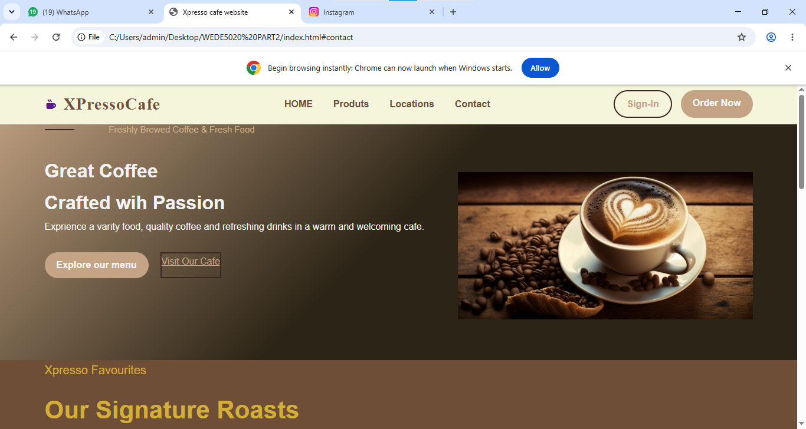
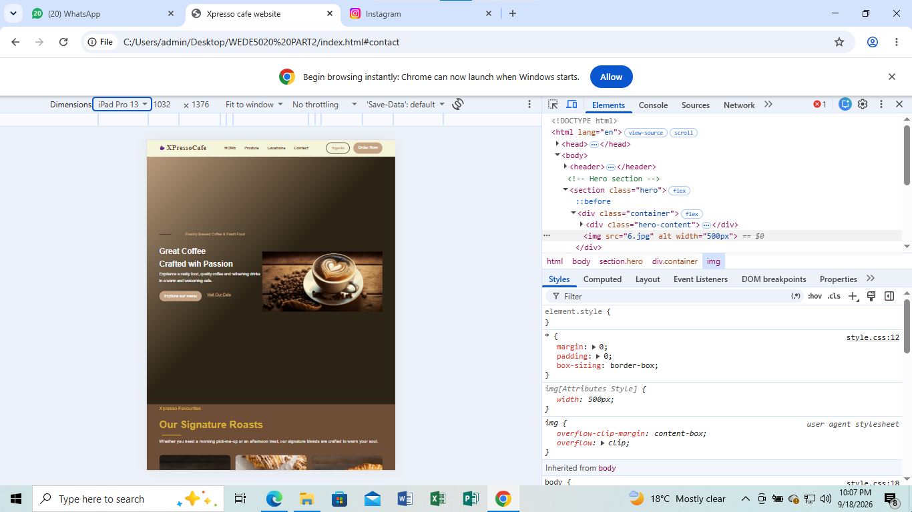
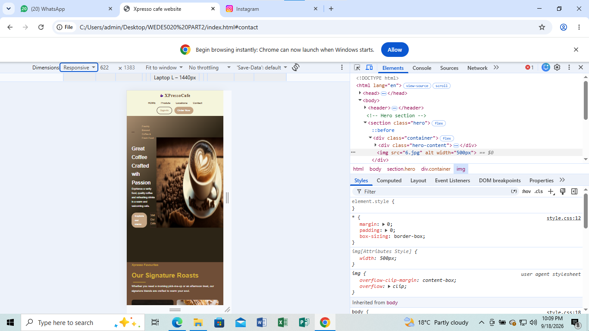

 # XPressoCafe - Part 2

## Changelog
**Date: 18-09-2026**

- **Fixed Part 1 HTML feedback:** Added proper HTML structure using header, nav, main, and footer tags.
- **External CSS:** Created a style.css file and linked it to the HTML.
- **CSS Reset:** Added a reset to fix browser differences.
- **Base Styles:** Added a color scheme and font styles.
- **Layout:** Used CSS Grid for the product cards and Flexbox for the navigation.
- **Visuals:** Added borders, box shadows, and hover effects to buttons and cards.
- **Responsive Design:** Added media queries so the website works on tablets and mobile phones. The layout switches from 3 columns to 1 column.
- **Responsive Images:** Added srcset and sizes to the product images.

## Screenshots

### Desktop

### Tablet

### Mobile

## Part 3 Final Submission
- Fixed Part 2 feedback: Order Now and Sign-In buttons now work.
- I added interactive cart, search filter, and Google Maps.
- I added form validation to contact.html and enquiry.html.
- Implemented SEO (Meta tags, Alt text, robots.txt, sitemap.xml).
- Implemented an image lightbox popup.

## SEO Discussion

**1. Define SEO and explain its purpose in web development.**
SEO stands for Search Engine Optimization. Its purpose is to help your website show up on Google when people search for things. It makes it easier for search engines to read your site and send free visitors to your pages.

**2. Explain how SEO practices can improve user experience (UX) and website performance.**
Good SEO makes the website better for the user. When you focus on making a site fast and mobile-friendly (like using CSS media queries), it helps both Google's ranking and the customer's experience. People leave websites that are slow or hard to use.

**3. Discuss the benefits of implementing SEO on a website.**
The biggest benefit is getting free traffic from people who are actually looking for what you offer. For XPressoCafe, it helps local people find the cafe when they search for "cheap coffee" or "pies". It builds trust and saves money on advertising.

**4. Explain and demonstrate specific SEO techniques using HTML, CSS and JavaScript where applicable.**
I used HTML heading tags like `<h1>` and `<h2>` so search engines know what the main topics are. I also added `alt` text to my images (like `alt="XPresso Coffee Cup"`). My CSS is mobile-friendly, which Google likes, and my JavaScript cart makes the site interactive.

**5. Explain the purpose of HTML meta elements and demonstrate relevant examples.**
Meta elements are hidden tags in the `<head>` section that give search engines a summary of the page. 
Example: `<meta name="description" content="XPressoCafe - Freshly brewed coffee, quiches, pies, and slushies. Everything costs only R14.">`

## Netlify Live Link:** https://tourmaline-panda-2a7750.netlify.app
## GitHub Link:** https://github.com/thabisileskhosana4-source/WEDE5020-Part2.git
## References
- MDN Web Docs. (2024). *JavaScript DOM Manipulation*.
- W3Schools. (2024). *HTML Forms*.
- Google Maps Platform. (2024). *Embedding a map*.

